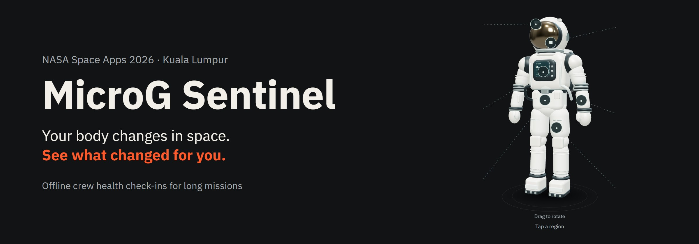
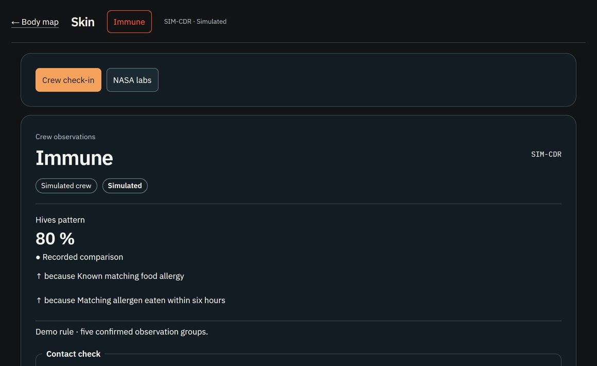
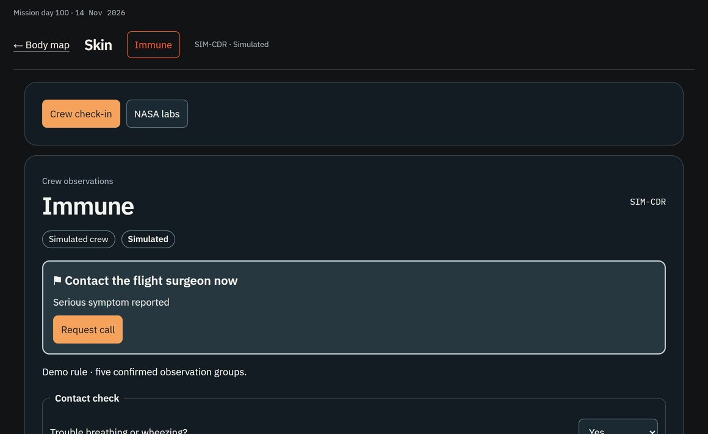
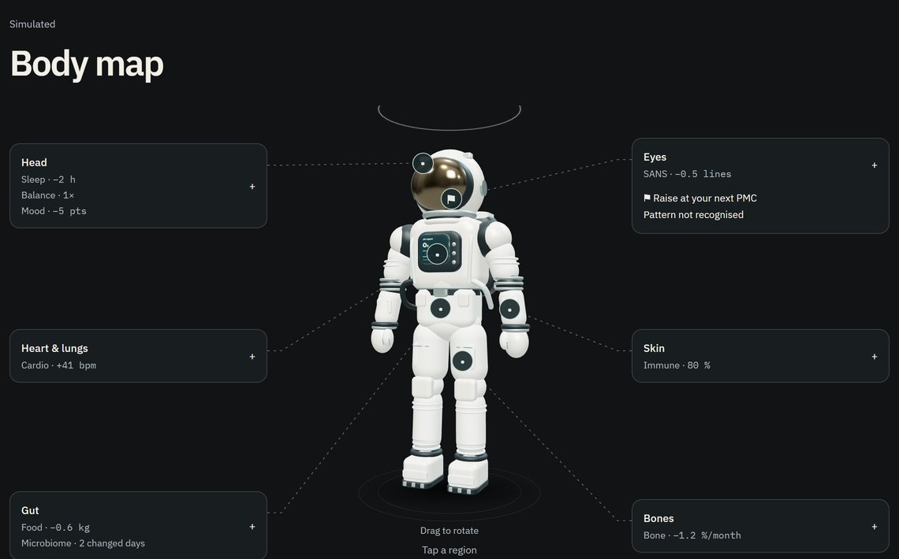
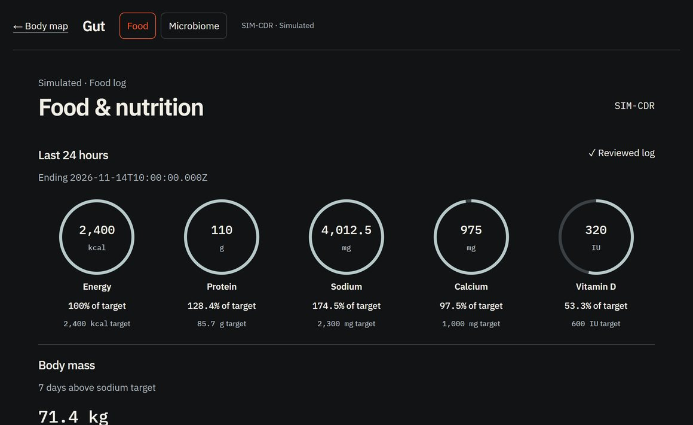
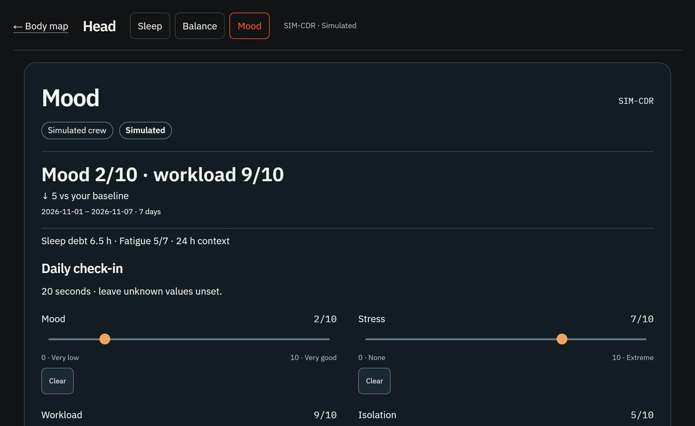
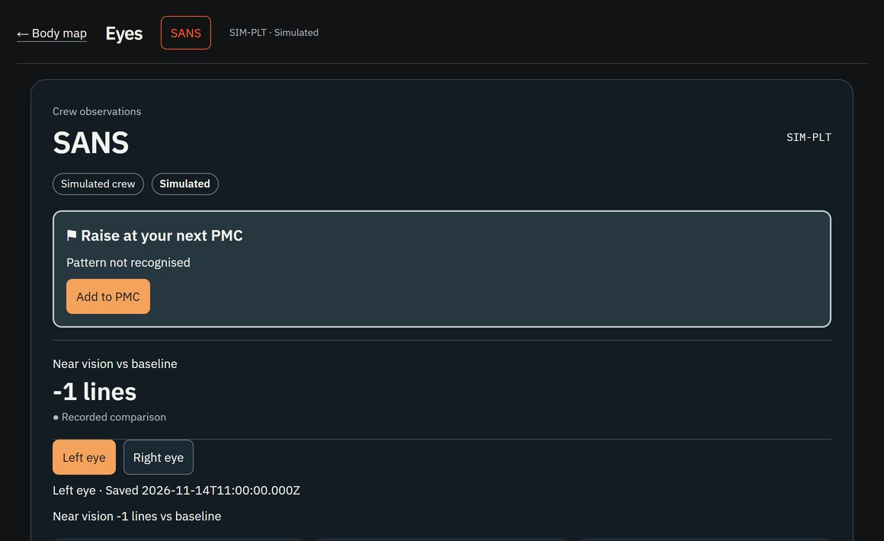
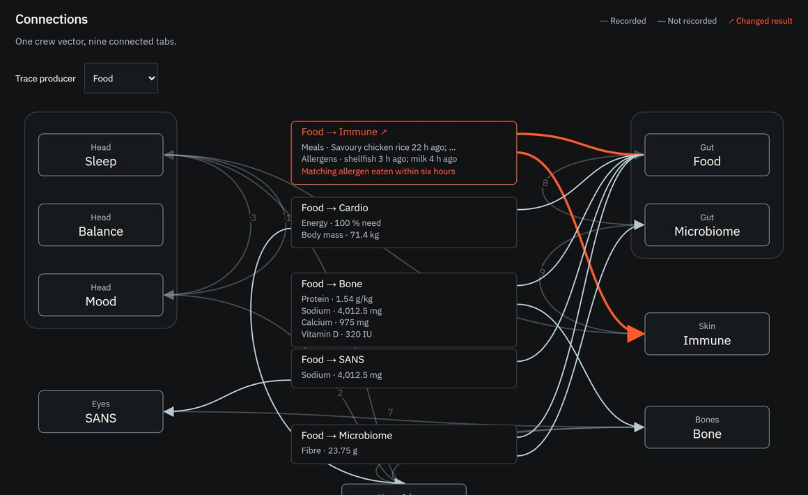
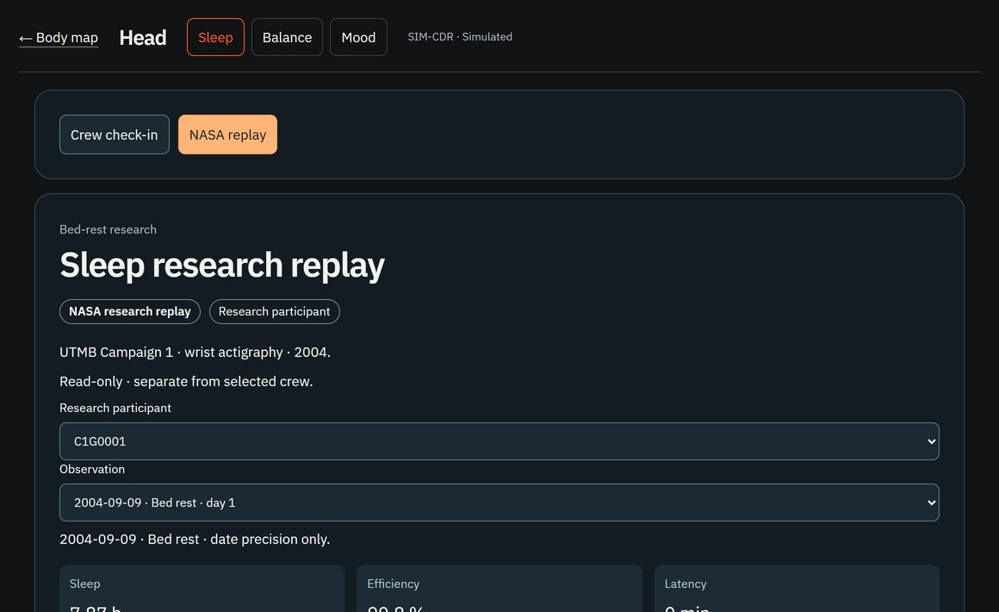
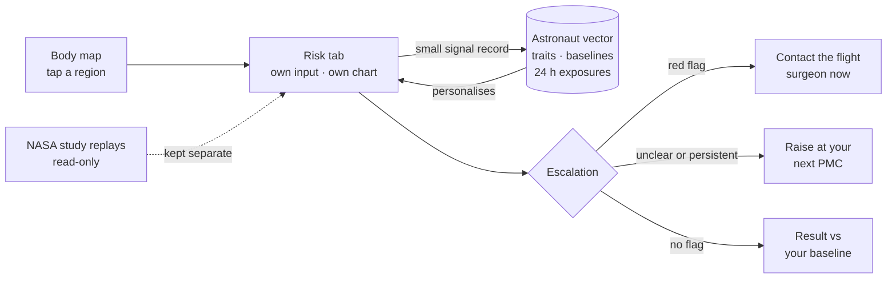

<p align="center">
  
</p>

<p align="center">
  <a href="https://cdn.jsdelivr.net/gh/S-W-Leong/microG-sentinel@a045e81009d1/docs/demo/MicroG-Sentinel-demo.mp4"></a>
  <a href="https://micro-g-sentinel.vercel.app/"></a>
  <a href="docs/slides/MicroG-Sentinel-slides.pdf"></a>
</p>

<p align="center">
  <b>Tap where it feels different. See what changed. Know when to call the flight surgeon.</b><br>
  Team (SW)² · Siang Woo &amp; Shi Wei · NASA Space Apps Challenge 2026 · Kuala Lumpur<br>
  Challenge: <i>Create Health Monitoring Software for Astronauts on Space Missions</i>
</p>

---

MicroG Sentinel is an offline health check-in app for astronauts on long missions. On the ISS, crew members speak privately with their flight surgeon about once a week; on the way to Mars, a message takes up to 20 minutes each way. Between those calls, the app answers three questions: **what changed in my body**, **compared with my own normal**, and **does it need the flight surgeon now**.

Results are pattern matches or changes from a personal baseline, never diagnoses. The app gives no treatment advice. All crew data in the demo is simulated and labelled.

## Watch the demo

[**▶ 41-second walkthrough with voice-over**](https://cdn.jsdelivr.net/gh/S-W-Leong/microG-sentinel@a045e81009d1/docs/demo/MicroG-Sentinel-demo.mp4): body map, Food, Immune 80%, a red flag, and the NASA lab replay. Screen recording of the live app; simulated crew data.

## One meal, followed through two tabs

> **The Commander has a shellfish allergy. They had shrimp rice at 08:00.**
> At 11:00 they photograph a rash and manually confirm the observations. **3 of 5** confirmed hives signs match, a **60%** base match. The astronaut vector adds **+10** for the declared allergy and **+10** because the allergen was eaten within six hours: **80%**, with both reasons listed under the score.
>
> Then they answer **Yes** to *trouble breathing*. The score disappears. The app says one thing: **Contact the flight surgeon now.**

<table>
  <tr>
    <td width="50%"><br><b>80%, with its reasons.</b> Food and the crew profile feed the Immune result; each adjustment is shown, never hidden.</td>
    <td width="50%"><br><b>A red flag replaces the score.</b> Serious answers never get a percentage, only a hand-off.</td>
  </tr>
</table>

## Walk through a check-in

<table>
  <tr>
    <td width="50%"><br><b>1 · Body map.</b> A 3D astronaut with six regions. Each card shows that region's latest results; a flag means something needs attention.</td>
    <td width="50%"><br><b>2 · Log.</b> Each tab has its own input. Food logs meals against daily targets and tracks body mass.</td>
  </tr>
  <tr>
    <td><br><b>3 · Compare with your own normal.</b> Mood 2/10 is shown as 5 points below this person's baseline, next to their sleep debt.</td>
    <td><br><b>4 · Escalate the unclear.</b> A change that matches no known pattern goes on the list for the next private medical conference (PMC).</td>
  </tr>
  <tr>
    <td><br><b>5 · See the connections.</b> The crew profile shows the astronaut vector and which tab changed which result.</td>
    <td><br><b>6 · Check against NASA data.</b> All nine tabs include a read-only replay of a real NASA study, kept apart from crew data.</td>
  </tr>
</table>

## How it works



Each tab publishes a small, typed signal record to the astronaut vector and reads other tabs' signals through it. Code does every calculation; personalisation weights are documented rules, not a trained model. Nothing leaves the device.

## NASA's five hazards, mapped to the body

| NASA hazard | Tabs | Body map region |
|---|---|---|
| Altered gravity | Cardio · Bone · Balance · SANS | Heart & lungs · Bones · Head · Eyes |
| Isolation and confinement | Sleep · Mood | Head |
| Hostile, closed environment | Immune · Microbiome · Food | Skin · Gut |
| Radiation | Dose card (context only) | Body map home |
| Distance from Earth | Every red flag hands off to the flight surgeon | All |

| Tab | NASA risk | Input | Screening reference (Earth-population threshold) |
|---|---|---|---|
| Cardio | Reduced cardiorespiratory fitness | Exercise heart rate, VO₂peak report | VO₂peak < 80% of pre-mission (NASA-STD-3001) |
| Sleep | Sleep loss and circadian desynchronisation | Night log, sleepiness, fatigue | PSQI > 5 · KSS ≥ 7* |
| Immune | Altered immune response | Skin photo + five hives signs | UAS7 bands · Jackson cold score |
| Bone | Spaceflight-induced bone change | Medical-team DXA, resistance log | DXA Z-score ≤ −2.0* (display only) |
| Food | Inadequate nutrition | Meal log, body mass | MUST ≥ 2 |
| Balance | Sensorimotor change | 30 s stand test, symptom ratings | MISC ≥ 6 |
| Microbiome | Host–microorganism interactions | Gut check-in, Bristol scale | GSRS* (no fixed cut-off) |
| SANS | Neuro-ocular syndrome | Amsler grid, near vision, headache | Frisén grade ≥ 1 (medical entry) |
| Mood | Behavioural health | Daily sliders, PHQ-9 | PHQ-9 ≥ 10 |

\* Not yet checked against a primary source.

Scores are worded as "matches the pattern for follow-up", never "you have X". Thresholds and sources are listed under "Indicative clinical scores" in [the battleplan](docs/battleplan.md).

## Real NASA data, kept separate

| Tab | Study | Source |
|---|---|---|
| Cardio | MR080G bed-rest cycle ergometry, UTMB Flight Analog Campaign 3 | [NASA Life Sciences Portal](https://nlsp.nasa.gov/search/data/details/852cd84a-464d-572b-99ac-9555f4dda464?dataType=DATASETS) |
| Sleep | BRSMAct wrist actigraphy, UTMB Campaign 1 | [NASA Life Sciences Portal](https://nlsp.nasa.gov/search/data/details/e26501eb-7d7a-5012-8c8e-c5bdb3eecaf6?dataType=DATASETS) |
| Immune | OSD-575 Inspiration4 serum metabolic panel and cytokine arrays | [NASA OSDR](https://osdr.nasa.gov/bio/repo/data/studies/OSD-575) |
| Bone | MR035G DXA hip, spine and femur scans | [NASA Life Sciences Portal](https://nlsp.nasa.gov/search/data/details/96121725-e9bf-5084-82f9-9efd4696ae65?dataType=DATASETS) |
| Microbiome | OSD-574 Inspiration4 skin microbiome | [NASA OSDR](https://osdr.nasa.gov/bio/repo/data/studies/OSD-574) |
| SANS | OSD-679 / LSDS-81 head-down-tilt eye OCT, rats | [NASA OSDR](https://osdr.nasa.gov/bio/repo/data/studies/OSD-679) |
| Balance | BRSMFMT Functional Mobility Test, UTMB Campaign 1 | [NASA Life Sciences Portal](https://nlsp.nasa.gov/search/data/details/5fca791c-e1b8-5ee8-aba0-c6220789547e?dataType=DATASETS) |
| Mood | AD ASTRA CFT70, UTMB Campaign 11 | [NASA Life Sciences Portal](https://nlsp.nasa.gov/search/data/details/046fc310-ee58-5463-a2bf-3e8c1df7cb18?dataType=DATASETS) |
| Food | MR016G Dietary Intake, UTMB Campaign 3 | [NASA Life Sciences Portal](https://nlsp.nasa.gov/search/data/details/4d613f00-9304-5d1b-8d30-836bb2023079?dataType=DATASETS) |

Each replay is read-only: it never saves crew inputs, emits vector signals or invents timestamps. Raw downloads sit next to each replay's curation script, so every number can be traced to its source file. Research participants are kept separate from the app's crew. SANS uses rat ground-analog data because the human eye scans checked require a data request; these animal measurements are not human SANS findings. Curation notes: [`data/curated/`](data/curated/README.md) and each tab's research documentation.

Reference datasets cited in the tabs but not analysed in the demo: [Google SCIN](https://github.com/google-research-datasets/scin), [PhysioNet Sleep-EDF](https://www.physionet.org/content/sleep-edfx/1.0.0/), [USDA FoodData Central](https://fdc.nal.usda.gov/download-datasets.html), [CDC NHANES DXA](https://wwwn.cdc.gov/Nchs/Data/Nhanes/Public/2013/DataFiles/DXXSPN_H.htm).

## Run it

**Try it now:** [micro-g-sentinel.vercel.app](https://micro-g-sentinel.vercel.app/). No sign-in; everything runs in your browser.

To run it locally:

```sh
npm install
npm run dev
```

Open the URL Vite prints. The app opens on **mission day 100** with three simulated crew members; switch between them with the crew picker. Add `?scenario=off` to the address for a clean start. Everything runs offline after install; external dataset links need internet.

On Windows with Smart App Control, also run `npm install --no-save "rollup@npm:@rollup/wasm-node@4.68.3"` after installing, or the build is blocked.

| Check | Command |
|---|---|
| Unit tests | `npm test` |
| Types · lint · build | `npx tsc -b --noEmit` · `npm run lint` · `npm run build` |
| Browser tests | `npx playwright install chromium`, then `npm run test:e2e` |

## Challenge resources and how we used them

| Resource | How it shaped the app |
|---|---|
| [NASA: 5 Hazards of Human Spaceflight](https://www.nasa.gov/hrp/hazards/) | The body map is organised around them (table above). |
| [NASA: Risks of Human Spaceflight](https://www.nasa.gov/hrp/risks/) | Each tab is one named risk: 8 of the 17, plus radiation as context. Risks that are not personal readings (for example decompression sickness, hypoxia, landing injury) are left out on purpose. |
| [NASA: Ongoing HRP Research](https://www.nasa.gov/hrp/ongoing-hrp-research/) | ARCHeR (well-being, activity and sleep on Artemis II) models our Sleep, Mood and Balance check-ins. Standard Measures models our per-person baselines. Tempus Pro (crew health data to ground doctors) models the flight-surgeon hand-off. |
| [CSA: Monitoring Radiation for Astronaut Health](https://www.asc-csa.gc.ca/eng/news/articles/2026/2026-02-26-monitoring-radiation-astronaut-health.asp) | The radiation card shows mission dose against NASA's 600 mSv career limit and the neutron share measured by CSA's CANS detector (about 30% of ISS radiation). Dose values in the demo are simulated. |
| [CSA: Why Do We Conduct Science Experiments in Space?](https://www.asc-csa.gc.ca/eng/iss/science/why-do-we-conduct-science-experiments-in-space.asp) | Why we build on research data: bed-rest and spaceflight studies supply the real numbers, kept separate from crew data. |

## Project structure

React 19, TypeScript and Vite, with three.js for the body map and Observable Plot for charts. No backend.

| Path | What it is |
|---|---|
| `src/shell/` | Body map home, 3D astronaut, crew profile, radiation card, routing (`#/risk/<risk>?crewId=`) |
| `src/risks/<risk>/` | One folder per risk tab; each exports a `riskTab` descriptor, and all nine include a NASA replay |
| `src/risks/types.ts` | Shared contract: signals, vector API, evaluation, escalation |
| `src/vector/` | Astronaut vector: crew registry, signal store, exposures, personalisation |
| `src/scenario/` | Mission day 100 simulated crew stories |
| `src/screens/`, `src/exercise/`, `src/logic/` | Cardio exercise monitoring, NASA replay and VO₂ assessment routes |
| `data/raw/`, `data/curated/` | Untouched NASA MR080G download and its curated, cited subset |
| `design/astronaut-3d-v2/` | Approved 3D body map prototype; the app uses `src/shell/astronaut3d/` |
| `docs/battleplan.md` | Team plan, every tab's spec and the full signals contract |
| `docs/demo/` | 41-second demo video (screen recording, own voice-over) |
| `docs/slides/` | Seven-slide deck (PDF, PowerPoint), speaker notes and the scripts that build them |
| `docs/exercise-import.md`, `docs/exercise-evaluation.md`, `docs/source-claims.md` | Cardio import rules, evaluation limits and source citations |

Coding agents: read [`AGENTS.md`](AGENTS.md).

## Limitations

A hackathon prototype, not a clinical tool. It gives no diagnosis, clearance, treatment or exercise prescription. Personalisation weights are documented demo assumptions, not trained or validated. Screening thresholds come from Earth populations, not astronauts. Simulated data is always labelled. The NASA-STD-3001 80% reference applies to in-mission crew only; research records get no determination. VO₂peak and VO₂max stay distinct, and missing values are never treated as zero.

## AI tools used

We used AI tools (Claude, OpenAI Codex) for four kinds of work:

- **Research:** finding datasets, clinical screening scores and NASA background.
- **Data analysis:** curating the NASA datasets for the replays (see `data/curated/` and each tab's `research/` folder), checked against the source files.
- **Coding:** Codex wrote most of the code under Claude's review, including the three.js body map and the scripts that build the slides and README images.
- **Writing:** this README, the docs and the slide text.

No images, video or audio were AI-generated: the 3D astronaut is drawn by code, and the slide and README images are screenshots of the app. The app itself contains no AI model. This disclosure follows NASA Space Apps requirements; AI assistance does not establish clinical validity.

Interface resources: [IBM Plex](https://github.com/IBM/plex) fonts via [Fontsource](https://fontsource.org/), [Phosphor](https://phosphoricons.com/) icons, [Observable Plot](https://observablehq.com/plot/) charts, [three.js](https://threejs.org/) (MIT) for 3D.

---

<p align="center"><sub>Built by <b>(SW)²</b> for NASA Space Apps Challenge 2026 · Kuala Lumpur. Prototype, not for clinical use. Simulated crew data only.</sub></p>
